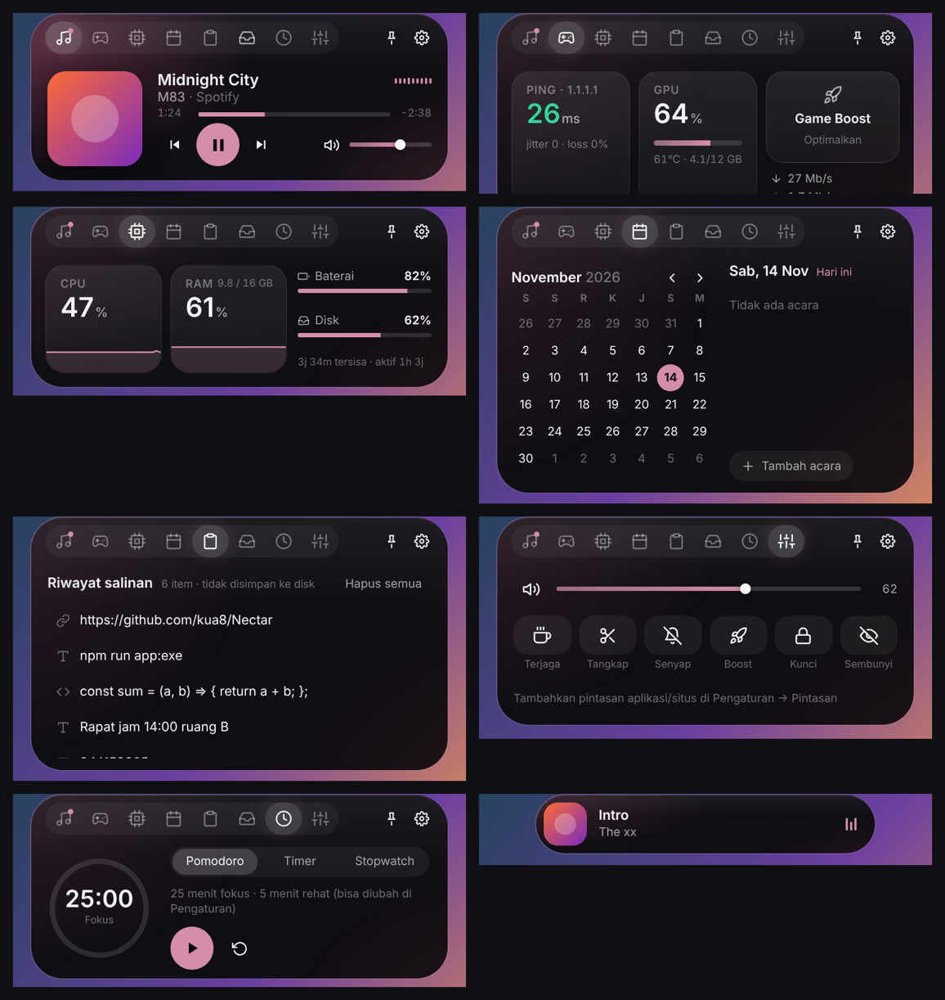
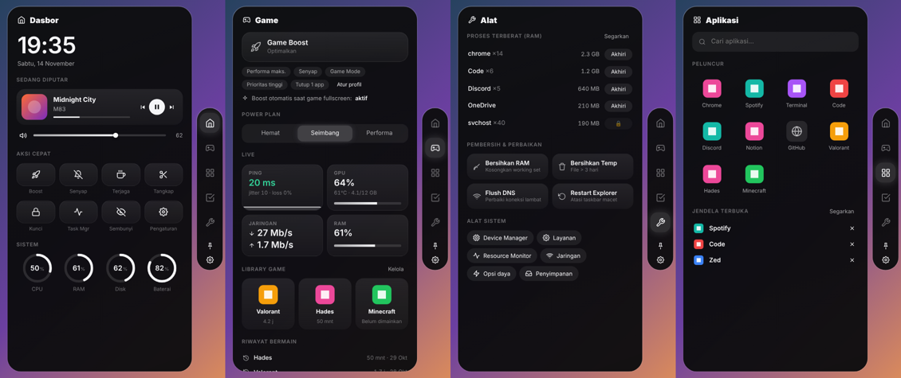
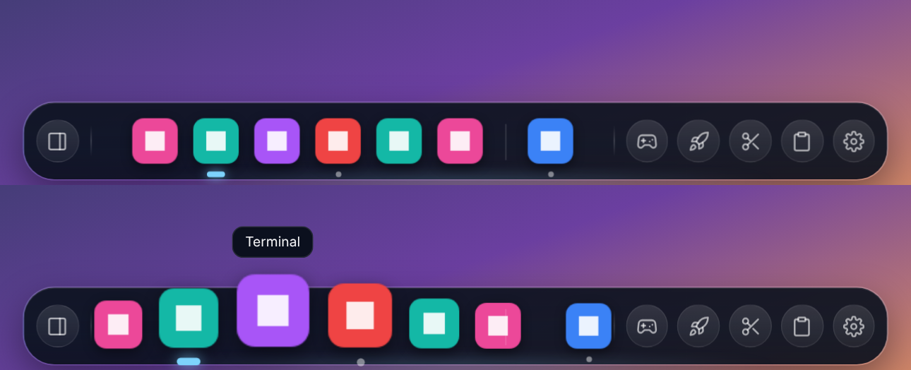
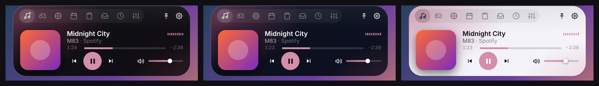
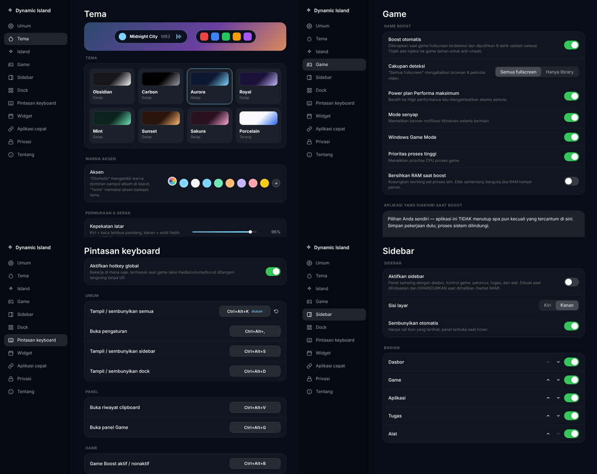

# Dynamic Island 3.0 — Windows 10/11 (Tauri v2 + React)

Satu aplikasi, tiga permukaan: **Island** (tengah-atas), **Dock/hotbar** (bawah), dan **Sidebar** (kiri/kanan) + jendela **Pengaturan**.
Digerakkan event Windows, **tanpa polling saat idle**, dan otomatis menghilang saat game fullscreen.







> Pratinjau dirender dari kode UI ini di Chromium headless dengan API Tauri ditiru (tanpa animasi spring).
> **Kode Rust/Win32 belum pernah dikompilasi** — lihat “Status verifikasi”.

## 1. Build jadi .exe
Prasyarat (sekali): Windows 10/11 x64 · Visual Studio Build Tools 2022 (workload *Desktop development with C++*) ·
Rust `x86_64-pc-windows-msvc` (https://rustup.rs) · Node.js 18+ · WebView2 Runtime.

```powershell
cd dynamic-island
build.bat            # atau: npm install && npm run app:exe
```
Hasil: `src-tauri\target\release\dynamic-island.exe` (juga disalin ke `release\DynamicIsland.exe`).
Installer: `npm run app:installer` · Dev: `npm run app:dev`.
Jika `audio.rs` gagal dikompilasi: `cd src-tauri && cargo build --release --no-default-features` (volume jadi no-op).

## 2. Yang baru di 3.0
**Optimisasi game**
- **Game Boost** (otomatis saat game fullscreen / manual via tombol, dock, sidebar, atau `Ctrl+Alt+B`): power plan *High performance*, mode senyap (banner notifikasi dimatikan), Windows Game Mode, prioritas proses game, bersihkan RAM, dan **daftar aplikasi latar yang Anda pilih sendiri** untuk diakhiri. **Semua dipulihkan** 8 dtk setelah game selesai (anti-bolak-balik saat Alt-Tab) atau saat aplikasi keluar. Tanpa injeksi/hook ke game → aman untuk anti-cheat.
- **Panel Game** (island & sidebar): ping + jitter + packet-loss (ICMP), GPU NVIDIA (util/suhu/VRAM), kecepatan unduh/unggah, CPU/RAM, ganti power plan, **library game dengan waktu bermain** otomatis, riwayat sesi.
- **Alat**: top proses (RAM) + akhiri proses (konfirmasi 2 klik, proses sistem dilindungi), bersihkan RAM/Temp/DNS, restart Explorer, pintasan Device Manager/Services/Resource Monitor/Network/Power.
- Island & dock **tersembunyi total saat game** (SW_HIDE, listener dilepas, React di-unmount) — aksi media/volume/boost lewat hotkey tetap jalan karena ditangani langsung di Rust.

**Sidebar baru (kiri/kanan, rail ikon → panel saat hover)**: Dasbor (jam, musik, aksi cepat, ring CPU/RAM/Disk/Baterai) · Game · Aplikasi (peluncur + pengganti jendela) · Tugas (to-do + catatan) · Alat. Dibuat saat dinyalakan, **dihancurkan saat dimatikan**.

**Dock/hotbar baru**: kaca bergradien + cahaya lantai, magnifikasi ala macOS, indikator berjalan berupa pil beraksen, **modul hotbar** (Sidebar, Game, Boost, Tangkap, Clipboard, Pengaturan — dapat diatur), seret untuk urut ulang, menu klik kanan, auto-hide.

**Tema & tampilan**: 8 tema (Obsidian, Carbon, Aurora, Royal, Mint, Sunset, Sakura, **Porcelain terang**), warna aksen (otomatis dari sampul / tema / preset / kustom), kepekatan kaca, intensitas glow tepi, kecepatan animasi — berlaku di semua jendela.

**Pintasan keyboard yang bisa diatur**: 15 aksi (+ `Ctrl+Alt+1…9` untuk dock) dengan perekam kombinasi, deteksi bentrok, dan penanda jika kombinasi sudah dipakai aplikasi lain.

Tetap ada dari v2: 8 panel island (Musik, Game, Sistem, Kalender+agenda+cuaca, Clipboard, Shelf, Fokus, Kontrol), toast live-activity, gestur (scroll=volume, klik tengah, klik kanan, dobel klik), clipboard manager, file shelf drag-out, visualizer dari peak audio nyata, ambient dari sampul, multi-monitor, profil performa Hemat/Seimbang/Ultra.

## 3. Pintasan keyboard bawaan (semua dapat diubah)
| Kombinasi | Aksi | Kombinasi | Aksi |
|---|---|---|---|
| `Ctrl+Alt+I` | Tampil/sembunyi semua | `Ctrl+Alt+Space` | Putar/jeda |
| `Ctrl+Alt+B` | Game Boost | `Ctrl+Alt+←/→` | Sebelumnya/berikutnya |
| `Ctrl+Alt+G` | Panel Game | `Ctrl+Alt+↑/↓` | Volume +/− |
| `Ctrl+Alt+S` | Sidebar | `Ctrl+Alt+M` | Bisukan |
| `Ctrl+Alt+D` | Dock | `Ctrl+Alt+P` | Tangkap layar |
| `Ctrl+Alt+V` | Riwayat clipboard | `Ctrl+Alt+L` | Kunci komputer |
| `Ctrl+Alt+,` | Pengaturan | `Ctrl+Alt+1…9` | Luncurkan item dock |

## 4. Arsitektur performa
| Prinsip | Implementasi |
|---|---|
| Tanpa polling | Foreground/fullscreen `SetWinEventHook` · media WinRT GSMTC · privasi `RegNotifyChangeKeyValue` · clipboard `AddClipboardFormatListener` · baterai `RegisterPowerSettingNotification` · hotkey `RegisterHotKey`. Semua thread tidur di `GetMessageW`/`recv()`/`WaitForMultipleObjects`. |
| Sampling hanya saat perlu | Ping/GPU/jaringan/CPU hanya selama panel Game/Sistem **terbuka** (timer dibersihkan saat ditutup); peak meter audio hanya saat panel Musik terbuka; daftar jendela dock hanya saat hover/foreground berganti. |
| Jendela dinamis | Dock, Sidebar, Pengaturan = webview terpisah yang **dibuat saat dibutuhkan & dihancurkan saat dimatikan**. |
| Click-through | `SetWindowRgn` membatasi jendela ke bentuk UI (kapsul/dock/rail+panel) — tanpa hook mouse. `WS_EX_NOACTIVATE`: klik tak mencuri fokus. |
| Animasi hemat GPU | Morph Framer Motion `layout` (transform-only), opacity, `scaleX/Y`; magnifikasi dock murni `transform`; profil Hemat memakai tween. |

**RAM jujur:** target < 25 MB tidak realistis untuk UI WebView2. Island saja ±40–80 MB setelah trim; dock/sidebar/pengaturan menambah satu renderer **selama menyala**.

## 5. Status verifikasi (jujur)
- ✅ **Frontend**: dibundel (esbuild) & dirender di Chromium headless. Lolos: wheel→volume, clipboard→paste, agenda+fokus keyboard, timer, hotkey→panel/sidebar/dock, Game Mode meng-unmount UI, tanpa listener ganda, polling Game berhenti setelah panel ditutup, `boost_profile`/`hotkeys_apply` dikirim benar, tema (termasuk terang + aksen kustom) diterapkan ke `:root`, persist & sinkron pengaturan, perekam hotkey, magnifikasi dock.
- ⚠️ **Rust/Win32 belum dikompilasi** (sandbox saya tanpa Rust). Tambahan v3 sengaja memakai FFI manual sederhana (ping `IcmpSendEcho`, `GetIfTable`, `powercfg`, registry) untuk menekan risiko; API `windows` 0.61 (WinRT, COM audio) tetap yang paling berisiko. Kirim pesan error kompilasi dan akan saya perbaiki.
- ⚠️ Perilaku nyata Windows perlu Anda uji: `powercfg` (skema High performance bisa tersembunyi di laptop modern — aplikasi mencoba membuatnya), `ToastEnabled` (efek tergantung build Windows), `nvidia-smi` (hanya NVIDIA), dan interaksi `SetWindowRgn` + WebView2 transparan.

## 6. Batasan yang disengaja
- **Tidak ada FPS counter**: butuh hook/ETW (PresentMon) yang berisiko dengan anti-cheat. Pakai Xbox Game Bar (`Win+G`) atau PresentMon.
- **GPU hanya NVIDIA** (via `nvidia-smi`); AMD/Intel menampilkan CPU/RAM.
- **Pembersih RAM** hanya mengosongkan working set (efek sementara, halaman dimuat ulang saat dibutuhkan) — bukan “mempercepat PC” secara ajaib.
- Belum ada: mixer volume per-aplikasi, preview jendela di dock, pengganti penuh taskbar, sinkron Google/Outlook Calendar, auto-update.

## 7. Catatan teknis
- `additionalBrowserArgs` di `tauri.conf.json` **harus identik** dengan `BROWSER_ARGS` di `src-tauri/src/wm.rs` (semua jendela berbagi satu environment WebView2).
- Pengaturan: `localStorage` WebView2, disinkronkan antar jendela lewat event `storage`. Riwayat bermain: `%APPDATA%\DynamicIsland\sessions.log`. Taskbar auto-hide: state di `%TEMP%\dynamic-island-taskbar.state` (dipulihkan saat exit/crash).
- Struktur: `src/island` · `src/side` · `src/dock` · `src/settings` · `src/shared` · `src/styles` · `src-tauri/src/{boost,tools,netinfo,procs,hub,apps,icons,audio,wm,media,fullscreen,window,privacy,stats,trim,sys}.rs`.
- Pemecahan masalah: `link.exe` tak ditemukan → pasang Build Tools C++ · game admin tak menyembunyikan UI → jalankan exe sebagai administrator · UI hilang → `Ctrl+Alt+I` atau tray → *Reset posisi*.
